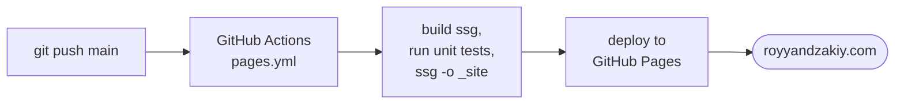
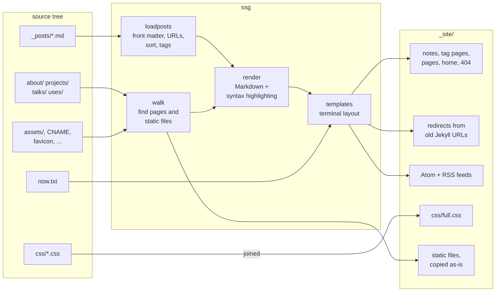
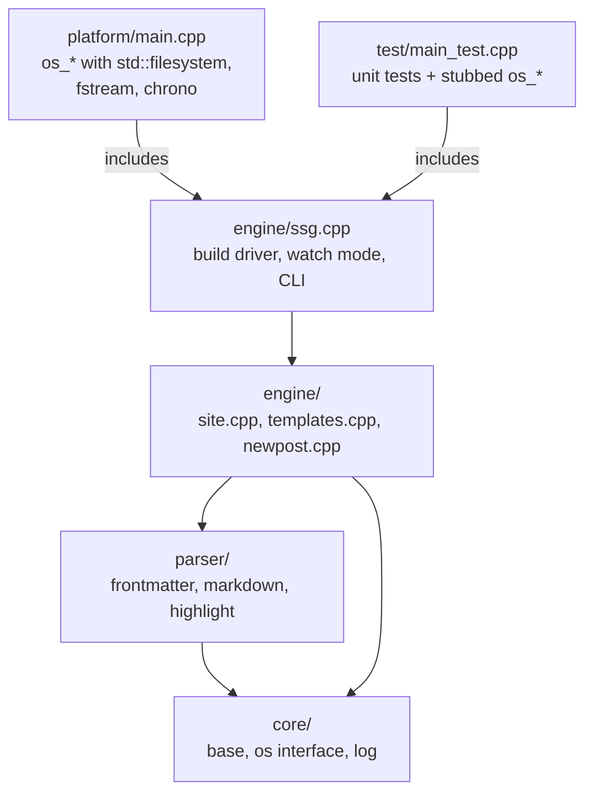

# royyandzakiy.com

The source of **[royyandzakiy.com](https://royyandzakiy.com/)**, the blog
of Royyan Dzakiy, an embedded engineer.

The whole site looks like a light terminal. Every page is the output of a
shell command: the home page is `whoami` plus `ls -l notes/`, the about
page is `man royyan`, the projects page is `tree projects/`. No
frameworks, no web fonts, no tracking. The home page is about 4 KB of
HTML plus one small stylesheet.

| Page | Command | Link |
|---|---|---|
| Notes | `ls -l notes/` | [royyandzakiy.com](https://royyandzakiy.com/) |
| Projects | `tree projects/` | [/projects/](https://royyandzakiy.com/projects/) |
| Talks | `column -t talks.csv` | [/talks/](https://royyandzakiy.com/talks/) |
| About | `man royyan` | [/about/](https://royyandzakiy.com/about/) |
| Uses | `neofetch` | [/uses/](https://royyandzakiy.com/uses/) |
| Feed | Atom | [/feed/](https://royyandzakiy.com/feed/) |

## How it's built

The generator is **ssg**, a small static site generator in standard C++23
that lives in [`_ssg/`](_ssg/). It reads Markdown posts, renders them
(with its own Markdown parser and syntax highlighter), and writes plain
HTML, tag pages, and Atom/RSS feeds. GitHub Actions builds and tests it,
generates the site, and deploys it to GitHub Pages on every push to
`main` ([`pages.yml`](.github/workflows/pages.yml)).

### What one ssg build does

ssg reads the whole source tree, renders it, and writes `_site/` from
scratch. `ssg -w` repeats this whenever a source file changes.

ssg started as the generator Chris Wellons wrote for
[nullprogram.com](https://nullprogram.com/), released into the public
domain. This fork moved it to standard C++23 types and a folder layout,
and added the terminal design.

It is a unity build: each executable is one translation unit. The entry
point includes `engine/ssg.cpp`, which includes everything else, so the
layers below only depend downward. All file and clock access goes through
a small `os_*` interface: implemented for real in the program, and
stubbed out in the unit tests.

    _ssg/core/       base types, strings, the os_* interface, logging
    _ssg/parser/     front matter, Markdown, syntax highlighting
    _ssg/engine/     site model, page templates, build driver
    _ssg/platform/   main.cpp: os_* with <filesystem>, <fstream>, <chrono>
    _ssg/test/       unit tests

Everything else in the repository is the site itself:

    _posts/          the notes, one Markdown file each
    about/ projects/ talks/ uses/    pages (Markdown + a little HTML)
    now.txt          what I'm doing now, shown on the home page
    css/             main.css, print.css, syntax.css (joined into full.css)
    assets/          images and the built demos
    _demos/          source of interactive demos embedded in posts
    _old/            the previous Jekyll site, kept for reference

Files and folders starting with `_` or `.` are never published.

## Build and run locally

Needs CMake and a C++23 compiler (clang++ or g++).

    $ cmake -S _ssg -B _ssg/build
    $ cmake --build _ssg/build
    $ ctest --test-dir _ssg/build           # unit tests
    $ _ssg/build/ssg -w                     # build _site/, rebuild on every change
    $ python -m http.server 8000 -d _site   # in a second terminal

Then open <http://localhost:8000>. Opening `_site/index.html` directly
won't load the styles, because pages use absolute paths (`/css/...`).

## Write a note

Add `_posts/YYYY-MM-DD-slug.md`:

    ---
    title: Hello, World
    layout: post
    tags: [cpp, zephyr]
    uuid: <any new UUID>
    ---

    Post body in Markdown.

Or write a draft whose first line is `# Title` and run
`_ssg/build/ssg -n draft.md` to file it into `_posts/` with today's date
and a fresh UUID. Notes appear at `/blog/YYYY-MM/slug/`; the old
`/YYYY-MM-DD/slug/` addresses redirect there.

A page (`about/index.md`, ...) picks the command shown above it in its
front matter; without one it shows `cat` of its own file:

    ---
    title: About
    command: man royyan
    ---

## License

Public domain ([UNLICENSE](UNLICENSE)), code and notes alike unless a note
says otherwise, like the generator it grew from.
